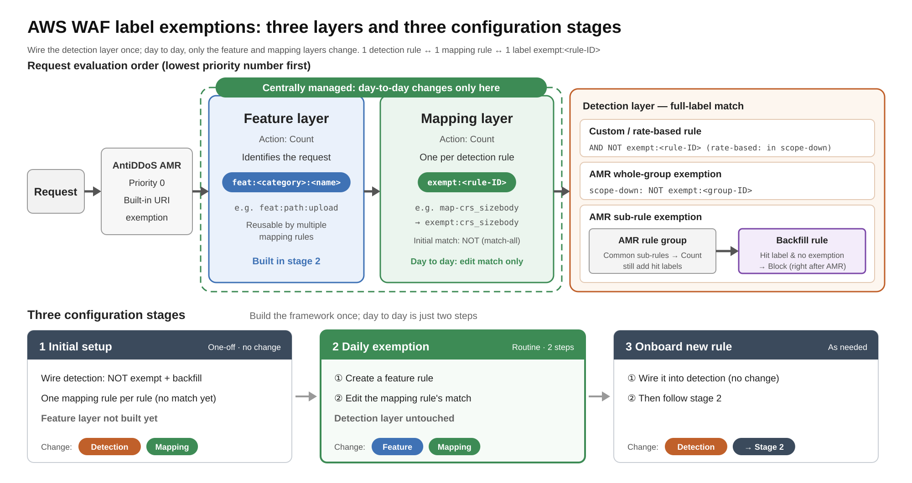

# AWS WAF Label-Based Exemption Framework / AWS WAF Label 豁免框架

A pattern for allow-list exemptions in AWS WAF: relax only the specific check a request needs to skip, keep every other check in place, and manage all exemptions centrally.

一套 AWS WAF 白名单豁免的写法：只放开需要放开的那一项检查，其余检查照常生效；所有豁免集中管理，一处修改、全局生效。



## Read / 阅读

| Language | Article |
|---|---|
| English | [en/README.md](en/README.md) |
| 中文 | [zh/README.md](zh/README.md) |

Each article has two parts / 每篇文章分两部分：

- **Part 1 – For humans / 给人读**: the problem, the three-layer design (feature → mapping → detection), the backfill rule for managed sub-rules, the three configuration stages, and a worked example.
- **Part 2 – For AI agents / 给 AI Agent 读**: guidelines, inputs, decision tree, step-by-step rule JSON and AWS CLI commands, verification, troubleshooting, and a deployment checklist.

## Core idea / 核心思路

| Layer / 层 | Action | Label |
|---|---|---|
| Feature / 特征层 | Count | `feat:<category>:<name>` |
| Mapping / 映射层 | Count | `exempt:<rule-ID>` (one mapping rule per exemptible rule) |
| Detection / 检测层 | Original action | `AND NOT exempt:<rule-ID>`; managed sub-rules → Count + backfill rule |

Wire the detection layer once; day-to-day exemptions only touch the feature and mapping layers.

检测层一次接好；日常增删豁免只改特征层和映射层。

## Repository layout / 目录结构

```
.
├── README.md
├── en/
│   ├── README.md
│   └── images/
└── zh/
    ├── README.md
    └── images/
```

## Disclaimer / 说明

This is a personal write-up based on public AWS WAF documentation, not official AWS guidance. Validate every change in a non-production web ACL first, and confirm the actual WCU usage with `CheckCapacity` before going live.

本文是基于 AWS WAF 公开文档整理的个人实践总结，不代表 AWS 官方指导。所有改动请先在非生产 web ACL 中验证，上线前用 `CheckCapacity` 核对实际 WCU。
