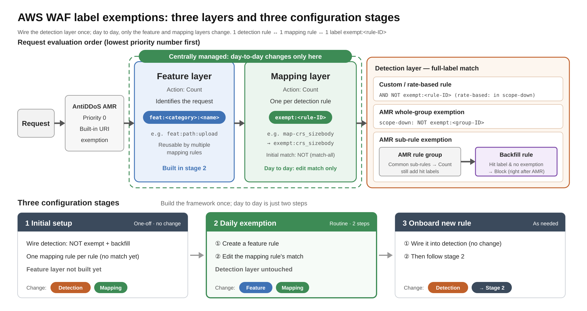
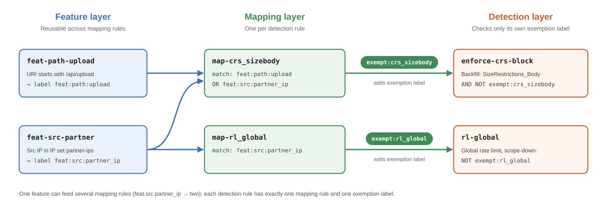
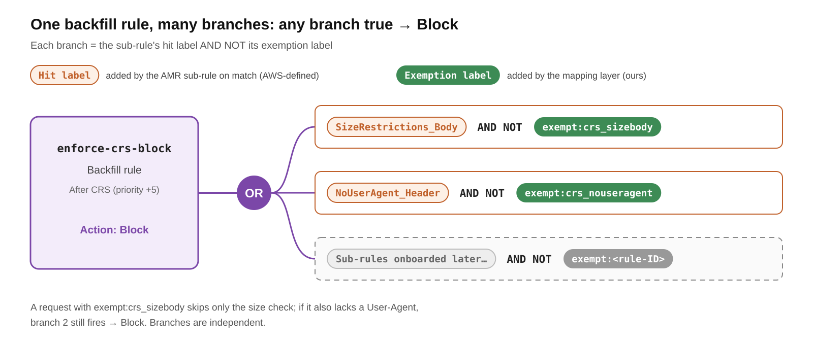

# AWS WAF Allow-List Exemptions with Labels: Change Once, Apply Everywhere

> [中文](../zh/README.md) | English


> In one sentence: label each request, then let the labels decide "who may skip which check". Wire the detection rules once; day-to-day allow-list changes only touch the feature and mapping layers.

---

# Part 1: For Humans

## 1. The problem: why allow-list exemptions are hard to write and hard to manage

Customers usually take one of two approaches to allow-list exemptions in AWS WAF, and both have pitfalls:

| Approach | How | Problem |
|---|---|---|
| Plain Allow | Add a high-priority rule that allows `/api/upload` | **Too broad**: Allow is a terminating action, so a match skips every rule after it, including the checks you still want |
| Per-rule exceptions | Add `AND NOT (path/IP...)` to every rule that needs an exemption | **Too scattered**: the same allow-list criterion lives in N rules; adding a new exemption source means editing N places, and it's easy to miss one |

What we want:

- **Precise**: relax only the one check that needs relaxing; everything else still applies.
- **Centralized**: maintain allow-list criteria in one place; change it once and every related rule picks it up.

## 2. Core idea: separate "who you are" from "what you may skip"

WAF rules can add **labels** to a request, and rules evaluated later can read them; the Count action only adds labels and never changes whether a request is allowed or blocked. Building on that, the allow list is split into three layers:



| Layer | Action | What it does | Label |
|---|---|---|---|
| **Feature layer** | Count | Identifies what the request is; one feature can be referenced by many mapping rules | `feat:<category>:<name>`, e.g. `feat:path:upload` |
| **Mapping layer** | Count | One per exemptible detection rule; if the request carries an allowed feature, add that rule's exemption label | `exempt:<rule-ID>`, e.g. `exempt:crs_sizebody` |
| **Detection layer** | Original action | Your existing rules; skipped when the request carries the rule's own exemption label | Matches `exempt:<rule-ID>` |

Think of airport security: the feature layer puts an "oversized bag" sticker on the traveler, the mapping layer is each checkpoint's exemption list, and each checkpoint only looks at its own list. A traveler exempt from the bag-size check still goes through the metal detector.



Benefits of the split:

- **The detection layer is configured once**: the exemption label is always `exempt:<rule-ID>` and is produced only by that rule's dedicated mapping rule, so adding exemptions never touches detection rules.
- **Change once, apply everywhere**: build a feature once and attach it to several mapping rules; update the feature definition (e.g. an IP set) and every reference picks it up.
- **Clear and traceable**: open a mapping rule to see exactly who can bypass that rule; in the logs, the `exempt:` label tells you which rule was skipped and the `feat:` label tells you why.

### How to wire the detection layer

| Rule type | How to wire it |
|---|---|
| Custom rule | Original condition `AND NOT exempt:<rule-ID>` |
| Rate-based rule | Add `NOT exempt:<rule-ID>` to the scope-down statement (combine with AND if a scope-down already exists) |
| Managed rule group (AMR), whole group | Add `NOT exempt:<group-ID>` to the scope-down statement |
| **A single sub-rule** of a managed rule group | Override the sub-rule to Count + a **backfill rule** right after the group |
| AntiDDoS AMR | Exception: keep it at priority 0 and use its built-in URI exemption setting |

The backfill rule works with two kinds of labels. Keep them apart:

| Label | Added by | Example | Meaning |
|---|---|---|---|
| **Hit label** | The AMR sub-rule, automatically, when it matches (AWS-defined) | `awswaf:managed:aws:core-rule-set:SizeRestrictions_Body` | The request triggered that sub-rule |
| **Exemption label** | The mapping layer (we define it) | `exempt:crs_sizebody` | The request may skip that sub-rule |

**Backfill rule**: you can't edit the conditions of a managed sub-rule, so you hand off enforcement. Override the sub-rule to Count so that it only adds its hit label and no longer blocks; the backfill rule right after the group then evaluates "**hit label present and no exemption label → original action (Block)**". The effect is the same as adding `NOT exempt` to the sub-rule.

A rule group needs only **one** backfill rule: OR together several branches, one per sub-rule it takes over; if any branch is true, the request is blocked. Each branch = that sub-rule's hit label **AND NOT** its exemption label. Only include sub-rules whose default action is Block; when you onboard another sub-rule later, just add one more branch.



## 3. Three configuration stages

**Idea: wire the detection layer once during initial setup; day to day, change only the feature and mapping layers.**

| Stage | What you do | Takes effect |
|---|---|---|
| **1. Initial setup** (one-off) | Build the mapping and detection layers; no feature rules yet | No change in behavior |
| **2. Day-to-day exemptions** (routine) | Create a feature rule, edit the mapping rule's match condition | Immediately |
| **3. Onboard a new rule** (as needed) | Wire the rule into the detection layer first, then follow stage 2 | Only the last step |

**Why does stage 1 change nothing?** Mapping rules start with a placeholder condition that never matches, so no exemption labels are added and the detection layer's `NOT exempt` has no effect. When you need an exemption, replace the placeholder with a feature label.

**Principle**: make every preparatory change behavior-neutral and let only the last step change behavior, so if something goes wrong you know exactly which step caused it.

### Initial setup essentials

1. **Register rule IDs**: assign an ID to every exemptible rule and never change it afterwards. Exemption labels and mapping rules are named after the ID: `exempt:<rule-ID>`, `map-<rule-ID>`.
2. **Wire only the commonly exempted managed sub-rules** (e.g. `SizeRestrictions_BODY`, `NoUserAgent_HEADER`): the backfill rule gets branches for these only, and they are overridden to Count; all other sub-rules stay as they are and keep blocking inside CRS, to be onboarded in stage 3 if needed. A typo in a backfill branch's hit label raises no error and silently turns that sub-rule off, so the fewer you wire, the lower the risk.

Sample registry:

| Rule | Rule ID |
|---|---|
| CRS `SizeRestrictions_BODY` | `crs_sizebody` |
| CRS `NoUserAgent_HEADER` | `crs_nouseragent` |
| Global rate limit `rl-global` | `rl_global` |

## 4. Worked example: walking through the three stages

The example uses the rule ID registry from Chapter 3. Every step is marked as **create** (new rule) or **modify** (existing rule).

### Stage 1: Initial setup (no exemption needs yet)

This stage is not tied to any scenario; it only builds the skeleton. The web ACL already has two rules: the global rate limit `rl-global` and the core rule set (CRS).

**Create**

| Priority | Rule | Layer | Content | Action |
|---|---|---|---|---|
| 20 | `map-crs_sizebody` | Mapping | Match: NOT (match-all), never matches; label: `exempt:crs_sizebody` | Count |
| 21 | `map-crs_nouseragent` | Mapping | Match: NOT (match-all), never matches; label: `exempt:crs_nouseragent` | Count |
| 22 | `map-rl_global` | Mapping | Match: NOT (match-all), never matches; label: `exempt:rl_global` | Count |
| 1005 | `enforce-crs-block` | Detection (backfill) | One rule, two OR'ed branches (sizebody, nouseragent); each branch = hit label **AND NOT** its exemption label | Block |

**Modify**

| Priority | Rule | Layer | Change |
|---|---|---|---|
| 300 | `rl-global` | Detection | Add scope-down: **NOT** `exempt:rl_global` (requests carrying the exemption label are not counted toward the rate limit) |
| 1000 | CRS | Detection | Override `SizeRestrictions_BODY` and `NoUserAgent_HEADER` to Count; other sub-rules unchanged |

**Feature layer**: not built yet; it comes in stage 2 when there's a concrete need.

About the mapping layer's "NOT (match-all)": WAF has no "match nothing" statement, so negate a condition that is true for every request, e.g. URI path length ≥ 0:

```json
"Statement": { "NotStatement": { "Statement": { "SizeConstraintStatement": {
  "FieldToMatch": { "UriPath": {} }, "ComparisonOperator": "GE", "Size": 0,
  "TextTransformations": [ { "Priority": 0, "Type": "NONE" } ] } } } }
```

This way each mapping rule is pre-loaded with its exemption label; no request can trigger it yet.

**Order of operations** (no step changes behavior):

| Step | Create / modify | Action | Why nothing changes |
|---|---|---|---|
| ① | — | Register rule IDs and decide which rules are exemptible | Planning only |
| ② | Create | Mapping placeholders `map-crs_sizebody`, `map-crs_nouseragent`, `map-rl_global` | They never match, so no labels are added |
| ③ | Modify | Add scope-down `NOT exempt:rl_global` to `rl-global` | No request carries that label |
| ④ | Create | Backfill rule `enforce-crs-block` (Block), with branches for these two sub-rules only | The CRS sub-rules still block, so requests stop inside CRS and never reach the backfill rule |
| ⑤ | Modify | Override `SizeRestrictions_BODY` and `NoUserAgent_HEADER` to Count in CRS | The sub-rules now only add hit labels; the backfill rule takes over blocking |

⚠️ Step ④ must come before step ⑤. Reverse them and, in between, oversized requests and requests without a User-Agent all get through.

**Verify**: after step ⑤, the backfill rule's hit count should be close to what these two sub-rules used to block; if it's 0, a backfill branch's hit label is misspelled and that sub-rule is effectively off.

### Stage 2: Day-to-day exemptions (create a feature rule + modify a mapping rule)

**Scenario**: request bodies sent to `/api/upload` often exceed 8 KB and are blocked by the CRS sub-rule `SizeRestrictions_BODY` (which checks whether the body is larger than 8,192 bytes; default action Block).

**Requirement A**: relax the size check for `/api/upload` only; every other check still applies to uploads; oversized requests to other paths are still blocked.

| Create / modify | Priority | Rule | Content |
|---|---|---|---|
| Create | 10 | `feat-path-upload` (feature layer, Count) | URI starts with `/api/upload` → add `feat:path:upload` |
| Modify | 20 | `map-crs_sizebody` (mapping layer) | Match: NOT (match-all) → **has `feat:path:upload`**; label unchanged |

Editing the mapping rule takes effect **immediately**. No detection rule changes: the backfill rule matches `exempt:crs_sizebody`, and only `map-crs_sizebody` produces that label.

How requests flow after the change:

```
/api/upload 20KB     → feat:path:upload → exempt:crs_sizebody → CRS adds hit label only → backfill: has exempt:crs_sizebody, allow ✅
/api/upload with XSS → same → CRS XSS sub-rule is still Block → blocked inside CRS ⛔ (other checks still apply)
/api/other  20KB     → no labels → CRS adds hit label only → backfill: hit label, no exempt:crs_sizebody → Block ⛔
```

**Requirement B**: partner IP ranges should also bypass the size check and the global rate limit.

| Create / modify | Priority | Rule | Content |
|---|---|---|---|
| Create | 11 | `feat-src-partner` (feature layer, Count) | Source IP in IP set `partner-ips` → add `feat:src:partner_ip` |
| Modify | 20 | `map-crs_sizebody` (mapping layer) | Match: `feat:path:upload` → `feat:path:upload` **OR** `feat:src:partner_ip` |
| Modify | 22 | `map-rl_global` (mapping layer) | Match: NOT (match-all) → **has `feat:src:partner_ip`** |

That's "change once, apply everywhere": build a feature once; whichever mapping rule you attach it to, that detection rule is exempted. When partner IPs change later, only update the IP set `partner-ips`, and both exemptions update at once.

**Requirement C**: a monitoring system runs health checks from a fixed IP range without a User-Agent and is blocked by the CRS sub-rule `NoUserAgent_HEADER`.

| Create / modify | Priority | Rule | Content |
|---|---|---|---|
| Create | 12 | `feat-src-monitor` (feature layer, Count) | Source IP in IP set `monitor-ips` → add `feat:src:monitor_ip` |
| Modify | 21 | `map-crs_nouseragent` (mapping layer) | Match: NOT (match-all) → **has `feat:src:monitor_ip`** |

Monitoring requests skip only the User-Agent check; the size check, the rate limit, and everything else still apply; requests from other sources without a User-Agent are still blocked by the backfill rule.

**How do I see why a request was exempted?** `exempt:crs_sizebody` tells you which rule was skipped, and the `feat:` labels on the same request (e.g. `feat:path:upload`, `feat:src:partner_ip`) tell you why. WAF logs record every label on a request, so reading both kinds together reconstructs "who was exempted from which rule, and why".

### Stage 3: Onboard a new rule (as needed)

**Requirement D**: an internal ops system accesses a file-management API from a fixed IP range, with relative paths such as `../` in the URI, and is blocked by CRS `GenericLFI_URIPATH` (which inspects the URI path for local file inclusion patterns). This sub-rule was **not onboarded** during initial setup: the backfill rule has no branch for it, the sub-rule is still Block, and there is no mapping rule.

| Step | Create / modify | Action | Effect |
|---|---|---|---|
| ① | — | Register the rule ID: `GenericLFI_URIPATH` → `crs_lfiuri` | Planning only |
| ② | Modify | Backfill rule `enforce-crs-block`: add the branch "`GenericLFI_URIPath` hit label **AND NOT** `exempt:crs_lfiuri`" | The sub-rule is still Block, so requests stop inside CRS; **no change** |
| ③ | Modify | Override `GenericLFI_URIPATH` to Count in CRS | The backfill rule takes over blocking; **no change** |
| ④ | Create | Feature layer: `feat-src-ops` (priority 13), source IP in IP set `ops-ips` → add `feat:src:ops_ip` | Adds a label only |
| ⑤ | Create | Mapping layer: `map-crs_lfiuri` (priority 23), has `feat:src:ops_ip` → add `exempt:crs_lfiuri` | **Takes effect from this step** |

⚠️ As in stage 1, step ② must come before step ③.

If the new rule is a custom or rate-based rule, steps ② and ③ become one step: for a custom rule, add `AND NOT exempt:<rule-ID>` to its condition; for a rate-based rule, add `NOT exempt:<rule-ID>` to its scope-down. Once onboarded, all future exemptions for that rule go back to stage 2.

## 5. Day-to-day management and rollback

Once a rule is onboarded, every add, remove, and rollback only touches the **feature / mapping layers**:

| Task | Create / modify | Action | Stage |
|---|---|---|---|
| Add an exemption feature | Create + modify | Create a feature rule (skip if one can be reused); OR the feature label into the target mapping rule's match condition | 2 |
| Adjust a feature's scope | Modify | Change only the feature rule or its IP set / regex set; every exemption that references it updates at once | 2 |
| Revoke one feature's exemption | Modify | Remove that feature label from the mapping rule's match condition | 2 |
| Revoke all exemptions for a rule | Modify | Change the mapping rule's match condition back to NOT (match-all); leave the detection layer as is | 2 |
| Exempt a rule that isn't onboarded yet | Modify + create | Wire it into the detection layer first, then create the feature and mapping rules | 3 |

## 6. Things to watch

1. **Order matters**: create the backfill rule (Block) first, then override the managed sub-rules to Count. Reverse them and, in between, requests that should be blocked all get through.
2. **Backfill rule right after its AMR**: placed earlier, it can't see the AMR's hit labels. Suggested priority = AMR priority + 5.
3. **Feature and mapping layers go first**: right after the AntiDDoS AMR (priority 0), ahead of all custom rules, rate-based rules, and AMRs; between the two, the mapping layer comes after the feature layer. A rule can only read labels added by rules evaluated before it: mapping rules read feature labels, and detection rules read exemption labels. Reserve priority ranges (e.g. feature 10–19, mapping 20–29, detection from 100).
4. **Use hit label names exactly as AWS publishes them**: sub-rule names and hit label names may differ in case (the hit label of `SizeRestrictions_BODY` is `SizeRestrictions_Body`). A typo raises no error; the branch just never matches, which turns the sub-rule off.
5. **Backfill branches only for sub-rules you take over that are currently blocking**: don't include sub-rules whose default action is Count, or requests that used to be only counted will start getting blocked. The same goes for sub-rules the customer has already overridden to Count.
6. **Review mapping-layer changes**: once the detection layer is wired, the mapping layer is the only exemption switch.
7. **Exemption labels are always `exempt:<rule-ID>`**: the detection layer matches the full label (Scope `LABEL`), and labels are case-sensitive. Don't add a suffix (e.g. `exempt:crs_sizebody:upload`), or the match fails and the exemption silently stops working.
8. **Reserve about 100 WCU**: the example adds only about 17 WCU in total (label match and IP set match cost 1 WCU each; a prefix string match costs 2 WCU). Most WCU goes to the feature layer: a feature rule that uses Contains matching or text transformations costs 10–20 WCU on its own. 100 WCU covers typical setups; include it in your web ACL budget and try to stay within the 1,500 WCU included in the base price. Use the `CheckCapacity` API to confirm the actual figure before going live.

## 7. When to use it

- Upload or import APIs need a larger request body limit, while every other check still applies;
- Fixed sources such as partners, monitoring probes, or internal systems need to bypass a few managed sub-rules or rate-based rules;
- Many allow-list entries change often and need centralized management, auditability, and fast rollback;
- Several rules share the same allow-list criteria (one IP range needs to bypass both a rate limit and a CRS sub-rule).

---

# Part 2: For AI Agents

## 2.1 Agent guidelines

1. **Read before you write**: before any change, run `get-web-acl` to get the full current configuration and `LockToken`, and check existing priorities, existing `feat:` / `exempt:` labels, and `map-*` rules. The rule ID registry is not stored in WAF; ask the user for it, or infer it from existing `map-<rule-ID>` rule names.
2. **Incremental changes**: `update-web-acl` takes the full Rules array; only add or change the target rules on top of the original JSON; don't reorder or delete unrelated rules.
3. **Decide the stage first**: target rule already onboarded → only create feature rules and modify the mapping rule's match condition; not onboarded → wire the detection layer first (no behavior change), and create or modify the mapping rule last (takes effect). Verify between steps.
4. **No destructive actions without approval**: before switching to Block, deleting rules, changing managed sub-rule overrides, or modifying a mapping rule's match condition, show the user the diff and get confirmation.
5. **Copy hit label names from the API**: always take managed rule group hit labels from `AvailableLabels` in `describe-managed-rule-group`; never type them from memory.
6. **Backfill branches only for sub-rules you take over**: in stage 1, only the common few (here `SizeRestrictions_BODY`, `NoUserAgent_HEADER`); add more in stage 3 as needed. Before adding a branch, confirm the sub-rule's default action is Block and that the customer hasn't overridden it to Count.
7. **One detection rule ↔ one mapping rule**; the exemption label is always `exempt:<rule-ID>`, with no suffix. Rule IDs are add-only and never change.
8. **Check placement by order**: AntiDDoS AMR → feature layer → mapping layer → detection layer (custom / rate-based / AMR, each backfill rule right after its AMR). If the customer edits rules in the console, priorities get renumbered; go by evaluation order, not by specific numbers.
9. **Keep WCU in check**: this framework reserves about 100 WCU; verify with `check-capacity` before submitting; prefer IP sets and prefix / exact matching for feature rules, and avoid Contains and text transformations where possible.

## 2.2 Inputs

| Parameter | Description | Example |
|---|---|---|
| `SCOPE` | web ACL scope | `REGIONAL` / `CLOUDFRONT` (the latter needs `--region us-east-1`) |
| `WEB_ACL_NAME` / `WEB_ACL_ID` | Target web ACL | `prod-acl` / `a1b2c3...` |
| Rule ID registry | Exemptible rule → rule ID / exemption label / mapping rule | `crs_sizebody` → `exempt:crs_sizebody` → `map-crs_sizebody` |
| Managed sub-rules onboarded up front | Commonly exempted sub-rules (stage 1 adds backfill branches and overrides them to Count) | `SizeRestrictions_BODY`, `NoUserAgent_HEADER` |
| Exemptible custom / rate-based rules | Rules wired with `NOT exempt` in stage 1 | `rl-global` |
| Target rule | The rule to exempt this time | `SizeRestrictions_BODY` |
| Exemption feature | Path / IP / header, etc., and its feature label | URI prefix `/api/upload` → `feat:path:upload`; IP set `partner-ips` → `feat:src:partner_ip` |

## 2.3 Decision tree

```
Is the target rule the AntiDDoS AMR?
├─ Yes → use its built-in URI exemption setting; done
└─ No → does the web ACL already have the framework (rule ID registry / map-* rules / backfill rule)?
        ├─ No → Stage 1: initial setup (Steps 1–4), then come back to this tree
        └─ Yes → is the target rule onboarded (map-<ID> exists and the detection layer is wired)?
                (custom: condition AND NOT exempt:<ID>; rate-based / AMR group: scope-down NOT exempt:<ID>;
                  AMR sub-rule: backfill branch exists AND overridden to Count)
                ├─ Yes → Stage 2:
                │       feature label exists? No → create the feature rule (Step 5)
                │       → modify map-<ID>'s match condition to add the feature (Step 6)
                └─ No → Stage 3:
                        ├─ Custom       → register ID → condition AND NOT exempt:<ID> (Step 2)
                        ├─ Rate-based   → register ID → scope-down NOT exempt:<ID> (Step 2)
                        ├─ AMR group    → register ID → scope-down NOT exempt:<group-ID> (Step 2)
                        └─ AMR sub-rule → register ID → add a backfill branch (Step 3)
                                         → override the sub-rule to Count (Step 4)
                        → create the feature rule (Step 5) → create map-<ID> with the feature condition (Step 6, takes effect)
```

## 2.4 Steps

### Step 0: Read the current state

```bash
SCOPE=REGIONAL                 # TODO: replace with actual values
WEB_ACL_NAME=prod-acl          # TODO
WEB_ACL_ID=xxxxxxxx            # TODO

aws wafv2 get-web-acl --scope $SCOPE --name $WEB_ACL_NAME --id $WEB_ACL_ID > acl.json
LOCK_TOKEN=$(jq -r '.LockToken' acl.json)
jq '.WebACL.Rules[] | {Name, Priority}' acl.json

# All hit labels of the managed rule group (copy backfill labels from here)
aws wafv2 describe-managed-rule-group --scope $SCOPE \
  --vendor-name AWS --name AWSManagedRulesCommonRuleSet \
  --query 'AvailableLabels[].Name'
```

Expected: the existing rules and priorities are listed; the label list includes `awswaf:managed:aws:core-rule-set:SizeRestrictions_Body`.

### Step 1 (Stage 1, create): Mapping-layer placeholder rules

One per exemptible detection rule, with a NOT (match-all) condition that never matches:

```json
{
  "Name": "map-crs_sizebody",
  "Priority": 20,
  "Statement": { "NotStatement": { "Statement": { "SizeConstraintStatement": {
    "FieldToMatch": { "UriPath": {} },
    "ComparisonOperator": "GE",
    "Size": 0,
    "TextTransformations": [ { "Priority": 0, "Type": "NONE" } ] } } } },
  "Action": { "Count": {} },
  "RuleLabels": [ { "Name": "exempt:crs_sizebody" } ],
  "VisibilityConfig": { "SampledRequestsEnabled": true, "CloudWatchMetricsEnabled": true, "MetricName": "map-crs_sizebody" }
}
```

`map-crs_nouseragent` (`Priority` 21, label `exempt:crs_nouseragent`) and `map-rl_global` (`Priority` 22, label `exempt:rl_global`) use the same structure. Verify: the mapping rules have 0 hits.

### Step 2 (Stage 1 / 3, modify): Wire `NOT exempt` into custom, rate-based, and whole-group AMR rules

Rate-based rule: add `NOT exempt` to the scope-down. The global rate limit has no scope-down to begin with, so just add a `NotStatement`; if a scope-down already exists, combine the original condition and the `NotStatement` with an `AndStatement`:

```json
{
  "Name": "rl-global",
  "Priority": 300,
  "Statement": { "RateBasedStatement": {
    "Limit": 2000,
    "EvaluationWindowSec": 300,
    "AggregateKeyType": "IP",
    "ScopeDownStatement": { "NotStatement": { "Statement": {
      "LabelMatchStatement": { "Scope": "LABEL", "Key": "exempt:rl_global" } } } }
  }},
  "Action": { "Block": {} },
  "VisibilityConfig": { "SampledRequestsEnabled": true, "CloudWatchMetricsEnabled": true, "MetricName": "rl-global" }
}
```

Keep the customer's existing `Limit` and `EvaluationWindowSec` (TODO). Custom rules work the same way: combine the original `Statement` and the `NotStatement` with an `AndStatement`.

AMR whole group: add a scope-down to the `ManagedRuleGroupStatement` (leave other fields unchanged; if a scope-down already exists, combine with an `AndStatement`):

```json
"ScopeDownStatement": { "NotStatement": { "Statement": {
  "LabelMatchStatement": { "Scope": "LABEL", "Key": "exempt:amr_botctrl" } } } }
```

`exempt:amr_botctrl` is illustrative (e.g. exempting the whole Bot Control group); replace it with the group ID from the registry.

Verify: there are no exemption labels yet, so hit counts should match what they were before the change.

### Step 3 (Stage 1 / 3, create or modify): Backfill rule (Block)

One backfill rule per rule group; under `OrStatement`, one `AndStatement` branch (hit label AND NOT exemption label) per sub-rule it takes over (the common few in stage 1). `OrStatement` needs at least two sub-statements; with a single branch, use the `AndStatement` directly. Priority = AMR priority + 5. This structure must be pasted into the console's Rule JSON editor.

```json
{
  "Name": "enforce-crs-block",
  "Priority": 1005,
  "Statement": { "OrStatement": { "Statements": [
    { "AndStatement": { "Statements": [
      { "LabelMatchStatement": { "Scope": "LABEL", "Key": "awswaf:managed:aws:core-rule-set:SizeRestrictions_Body" } },
      { "NotStatement": { "Statement": { "LabelMatchStatement": { "Scope": "LABEL", "Key": "exempt:crs_sizebody" } } } }
    ]}},
    { "AndStatement": { "Statements": [
      { "LabelMatchStatement": { "Scope": "LABEL", "Key": "awswaf:managed:aws:core-rule-set:NoUserAgent_Header" } },
      { "NotStatement": { "Statement": { "LabelMatchStatement": { "Scope": "LABEL", "Key": "exempt:crs_nouseragent" } } } }
    ]}}
  ]}},
  "Action": { "Block": {} },
  "VisibilityConfig": { "SampledRequestsEnabled": true, "CloudWatchMetricsEnabled": true, "MetricName": "enforce-crs-block" }
}
```

When onboarding another sub-rule in stage 3, add a branch with the same structure (e.g. `GenericLFI_URIPath` / `exempt:crs_lfiuri`), copying the hit label name from `AvailableLabels` in Step 0.

Only include sub-rules whose default action is Block and that the customer hasn't overridden to Count. At this point those sub-rules are still Block, so requests stop inside CRS and the backfill rule changes nothing.

### Step 4 (Stage 1 / 3, modify): Override managed sub-rules to Count

Prerequisite: the Step 3 backfill rule is in place (Block) with a branch for this sub-rule. Add to the CRS `ManagedRuleGroupStatement`:

```json
"RuleActionOverrides": [
  { "Name": "SizeRestrictions_BODY", "ActionToUse": { "Count": {} } },
  { "Name": "NoUserAgent_HEADER", "ActionToUse": { "Count": {} } }
]
```

Note: this uses the **sub-rule name** (`SizeRestrictions_BODY`), while the backfill rule uses the **hit label name** (`SizeRestrictions_Body`). Stage 1 only overrides the few onboarded up front (two here); stage 3 adds more as needed (e.g. `GenericLFI_URIPATH`).

Verify: the backfill rule's hit count should be close to what these sub-rules used to block, and total blocks stay the same; if it's 0, a backfill branch's hit label is misspelled and the sub-rule is effectively off, so roll back the override immediately.

### Step 5 (Stage 2 / 3, create): Feature-layer rules

Skip if an existing feature can be reused. Path-based:

```json
{
  "Name": "feat-path-upload",
  "Priority": 10,
  "Statement": { "ByteMatchStatement": {
    "FieldToMatch": { "UriPath": {} },
    "PositionalConstraint": "STARTS_WITH",
    "SearchString": "/api/upload",
    "TextTransformations": [ { "Priority": 0, "Type": "NONE" } ] } },
  "Action": { "Count": {} },
  "RuleLabels": [ { "Name": "feat:path:upload" } ],
  "VisibilityConfig": { "SampledRequestsEnabled": true, "CloudWatchMetricsEnabled": true, "MetricName": "feat-path-upload" }
}
```

IP-based:

```json
{
  "Name": "feat-src-partner",
  "Priority": 11,
  "Statement": { "IPSetReferenceStatement": { "ARN": "arn:aws:wafv2:REGION:ACCOUNT:regional/ipset/partner-ips/ID" } },
  "Action": { "Count": {} },
  "RuleLabels": [ { "Name": "feat:src:partner_ip" } ],
  "VisibilityConfig": { "SampledRequestsEnabled": true, "CloudWatchMetricsEnabled": true, "MetricName": "feat-src-partner" }
}
```

`feat-src-monitor` (`Priority` 12, `monitor-ips` → `feat:src:monitor_ip`) and `feat-src-ops` (`Priority` 13, `ops-ips` → `feat:src:ops_ip`) use the same structure.

Replace `SearchString`, `ARN` (TODO: replace with the actual IP set ARN; for CloudFront scope the format is `arn:aws:wafv2:us-east-1:ACCOUNT:global/ipset/NAME/ID`), `Name`, `MetricName`, and label names with the actual feature. Verify: feature rule hit counts match the expected traffic; behavior is unchanged at this point.

### Step 6 (Stage 2 modify / Stage 3 create): Mapping rule match condition (the step that takes effect)

With a single feature, replace `Statement` with a single label match:

```json
"Statement": { "LabelMatchStatement": { "Scope": "LABEL", "Key": "feat:path:upload" } }
```

With multiple features, use `OrStatement` (at least two sub-statements):

```json
"Statement": { "OrStatement": { "Statements": [
  { "LabelMatchStatement": { "Scope": "LABEL", "Key": "feat:path:upload" } },
  { "LabelMatchStatement": { "Scope": "LABEL", "Key": "feat:src:partner_ip" } }
]}}
```

Keep `RuleLabels` (`exempt:<rule-ID>`), `Action` (Count), and `Priority` unchanged. To revoke all exemptions, change `Statement` back to the NOT (match-all) from Step 1.

Creating a mapping rule in stage 3 (e.g. `map-crs_lfiuri`, `Priority` 23, label `exempt:crs_lfiuri`): follow the Step 1 structure and use the feature label match above (`feat:src:ops_ip`) as the `Statement`.

### Step 7: Submit the update

```bash
# Write the modified Rules array to rules.json, then submit
aws wafv2 update-web-acl --scope $SCOPE --name $WEB_ACL_NAME --id $WEB_ACL_ID \
  --lock-token $LOCK_TOKEN \
  --default-action "$(jq -c '.WebACL.DefaultAction' acl.json)" \
  --visibility-config "$(jq -c '.WebACL.VisibilityConfig' acl.json)" \
  --rules file://rules.json
```

`update-web-acl` replaces the whole configuration: if `acl.json` contains fields such as `Description`, `CustomResponseBodies`, `CaptchaConfig`, `ChallengeConfig`, `TokenDomains`, or `AssociationConfig`, include them too, or they will be cleared. Add `--region us-east-1` for CloudFront scope.

Check capacity before submitting:

```bash
aws wafv2 check-capacity --scope $SCOPE --rules file://rules.json
```

After each submit, run `get-web-acl` again to get a new `LockToken`. For stages 1 and 3, submit and verify each step separately.

## 2.5 End-to-end verification

```bash
HOST=https://example.com       # TODO: replace with the actual domain
head -c 20480 /dev/zero | tr '\0' 'a' > big.bin

# 1) Large request to the exempted path → expect non-403
curl -s -o /dev/null -w "%{http_code}\n" -X POST --data-binary @big.bin $HOST/api/upload
# 2) Large request to another path → expect 403 (blocked by enforce-crs-block)
curl -s -o /dev/null -w "%{http_code}\n" -X POST --data-binary @big.bin $HOST/api/other
# 3) XSS on the exempted path → expect 403 (blocked by the CRS XSS sub-rule, proving other checks still apply)
curl -s -o /dev/null -w "%{http_code}\n" -X POST --data '<script>alert(1)</script>' $HOST/api/upload
# 4) No User-Agent from a non-monitoring IP → expect 403 (blocked by enforce-crs-block); the same request from a monitoring IP → expect non-403
curl -s -o /dev/null -w "%{http_code}\n" -H "User-Agent:" $HOST/
# 5) After stage 3: a path with ../ from a non-ops IP → expect 403; the same request from an ops IP → expect non-403
curl -s -o /dev/null -w "%{http_code}\n" --path-as-is "$HOST/files/../etc/passwd"   # TODO: replace with the actual file-management API path
```

CloudWatch Logs Insights queries:

```
# Requests exempted from crs_sizebody (the labels field also shows the feat: labels, i.e. the reason)
fields @timestamp, httpRequest.clientIp, httpRequest.uri, action, terminatingRuleId, @message
| filter @message like /exempt:crs_sizebody/
| sort @timestamp desc | limit 100

# Requests blocked by the backfill rule
fields @timestamp, httpRequest.clientIp, httpRequest.uri, labels.0.name, labels.1.name
| filter terminatingRuleId = "enforce-crs-block"
| sort @timestamp desc | limit 100
```

## 2.6 Troubleshooting

| Symptom | Cause | Fix |
|---|---|---|
| Mapping rule's match condition changed, but the exemption doesn't work | Target rule isn't wired into the detection layer (no `NOT exempt`, or the AMR sub-rule isn't overridden to Count) | Onboard it via stage 3 |
| Mapping rule matches, but the detection rule still blocks | Exemption label doesn't match the detection Key (extra suffix, different case); or the mapping layer sits after the detection rule | Standardize on `exempt:<rule-ID>` with Scope `LABEL`; move the feature and mapping layers ahead of all detection rules |
| Mapping rule never matches | Mapping rule sits before the feature rule and can't see the `feat:` label; or the feature label is misspelled | Put the mapping layer after the feature layer; check the label name |
| After overriding a sub-rule to Count, everything it should block gets through | Backfill rule not created yet, or missing that sub-rule's branch | Add and verify the backfill branch first, then override to Count |
| Backfill rule never matches; the sub-rule is effectively off | Hit label misspelled (e.g. written as `SizeRestrictions_BODY`) | Copy the hit label name from `AvailableLabels` |
| Backfill rule has no effect | It sits before the AMR and can't see the labels | Set its priority to AMR priority + 5 |
| Requests that used to be only counted are now blocked | The backfill rule includes a sub-rule whose default action is Count | Remove that branch; before adding a branch, confirm the sub-rule is currently Block |
| Saving the mapping rule fails | `OrStatement` has only one sub-statement | Use a plain `LabelMatchStatement` for a single feature |
| Other checks are skipped for exempted requests too | Allow was used instead of label-based exemption | Switch to the feature layer + mapping layer Count + label approach |
| Save fails with a capacity error | web ACL exceeds 5,000 WCU, typically because feature rules use Contains or text transformations | Locate with `check-capacity`; switch feature rules to IP sets and prefix / exact matching |
| CAPTCHA, custom responses, etc. disappear after submitting | `update-web-acl` was called without the original fields | Restore `CustomResponseBodies`, `CaptchaConfig`, etc. from `acl.json` and resubmit |

## 2.7 Deployment checklist

```
Stage 1 (one-off)
□ Current web ACL and LockToken read; no priority conflicts
□ Placement: AntiDDoS AMR → feature layer → mapping layer → detection layer (reserved ranges, e.g. 10–19 / 20–29 / from 100)
□ Rule ID registry in place: exemptible rule → ID / exempt:<ID> / map-<ID>
□ map-<ID> created for every exemptible rule: Count, NOT (match-all), label exempt:<ID>; 0 hits
□ Exemptible custom / rate-based / whole-group AMR rules wired with NOT exempt:<ID> (Scope=LABEL); hit counts unchanged
□ Backfill rule right after the AMR (+5), with branches for every sub-rule to be overridden to Count, each with NOT exempt; hit label names taken from AvailableLabels
□ Only the commonly exempted sub-rules onboarded up front are overridden to Count, and only after the backfill rule is in place; backfill hits ≈ previous blocks (0 means a misspelled hit label)
□ Feature layer not built (comes in stage 2)
□ check-capacity confirms the increase is within the reserved 100 WCU; original CustomResponseBodies / CaptchaConfig etc. kept on submit

Stage 2 (each exemption)
□ Target rule is wired into the detection layer
□ Feature rule created (or an existing one reused), with a priority ahead of the mapping layer
□ map-<ID> match condition modified with user approval; label stays exempt:<ID>
□ curl checks pass; logs show both exempt: and feat: labels

Stage 3 (onboard a new rule)
□ Rule ID registered
□ AMR sub-rule: add the backfill branch first, then override the sub-rule to Count; custom / rate-based: wire NOT exempt; verify no behavior change after each step
□ Then create the feature and mapping rules (mapping last; this takes effect)
□ Registry updated
```
