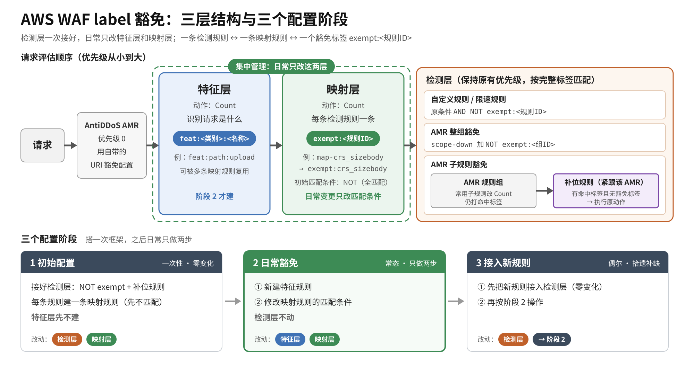
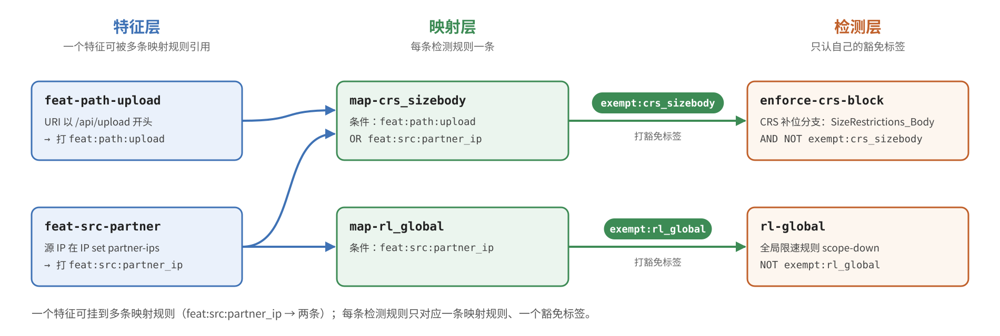
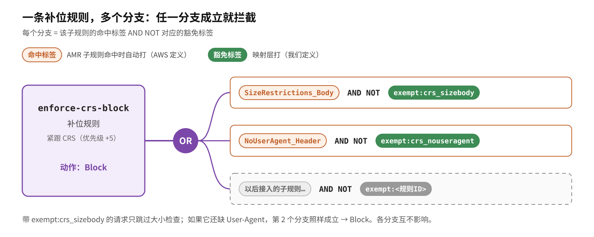

# AWS WAF 白名单豁免：用 Label 做到"一处修改，全局生效"

> 中文 | [English](../en/README.md)


> 一句话：给请求贴标签，用标签决定"谁可以免检哪一项"。检测规则一次接好，日常增删白名单只改特征层和映射层。

---

# Part 1：给人读

## 1. 问题：白名单为什么难写、难管

客户在 AWS WAF 里做白名单豁免，常见两种写法，都有坑：

| 写法 | 做法 | 问题 |
|---|---|---|
| 直接 Allow | 加一条高优先级规则放行 `/api/upload` | **放得太多**：Allow 是终止动作，命中后跳过后面所有规则，其它检查也一起不查了 |
| 逐条加例外 | 每条要豁免的规则里各写一遍 `AND NOT (路径/IP...)` | **改起来太散**：同一个白名单特征散落在 N 条规则里，新增一个 IP 要改 N 处，容易漏 |

我们想要的是：

- **精准**：只放开需要放开的那一项检查，其余检查照常；
- **集中**：白名单特征只在一个地方维护，改一处，所有相关规则同时生效。

## 2. 核心思路：把"你是谁"和"放过谁"拆开

WAF 规则可以给请求打 **label（标签）**，后面的规则能读到；Count 动作只打标签、不改变请求去留。据此把白名单拆成三层：



| 层 | 动作 | 做什么 | 标签 |
|---|---|---|---|
| **特征层** | Count | 识别请求"是什么"；一个特征可被多条映射规则引用 | `feat:<类别>:<名称>`，如 `feat:path:upload` |
| **映射层** | Count | 每条可豁免的检测规则对应一条，命中允许的特征就打豁免标签 | `exempt:<规则ID>`，如 `exempt:crs_sizebody` |
| **检测层** | 原动作 | 原有规则，带自己的豁免标签就跳过 | 匹配 `exempt:<规则ID>` |

好比安检：特征层贴"大件行李"贴纸，映射层是每个安检项目的免检名单，安检口只查名单。免量行李尺寸的旅客，照样要过金属探测。



这样拆开的好处：

- **检测层只配一次**：豁免标签固定为 `exempt:<规则ID>`，只由专属映射规则产生，新增豁免不用改检测规则；
- **一处修改、全局生效**：特征建一次，可挂到多条映射规则上；改 IP set 等特征定义，所有引用处同时生效；
- **一目了然、可追溯**：打开映射规则就能看到谁能绕过这条规则；日志里 `exempt:` 标签说明豁免了哪条规则，`feat:` 标签说明为什么。

### 检测层怎么接

| 规则类型 | 接入方式 |
|---|---|
| 自定义规则 | 原条件 `AND NOT exempt:<规则ID>` |
| 限速规则 | scope-down 加 `NOT exempt:<规则ID>`（已有 scope-down 时用 AND 组合） |
| 托管规则组（AMR）整组 | scope-down 加 `NOT exempt:<组ID>` |
| 托管规则组的**某条子规则** | 子规则改 Count + 紧跟一条**补位规则** |
| AntiDDoS AMR | 例外：放优先级 0，用自带的 URI 豁免配置 |

补位规则会同时用到两种标签，注意区分：

| 标签 | 谁打的 | 例子 | 含义 |
|---|---|---|---|
| **命中标签** | AMR 子规则命中时自动打（AWS 定义） | `awswaf:managed:aws:core-rule-set:SizeRestrictions_Body` | 这个请求触发了该子规则 |
| **豁免标签** | 映射层打（我们定义） | `exempt:crs_sizebody` | 这个请求可以跳过该子规则 |

**补位规则**：托管子规则改不了条件，就"换人执行"——子规则改 Count，命中时只打命中标签、不拦截；紧跟的补位规则判断"**有命中标签且无豁免标签 → 原动作（Block）**"，效果等同于给子规则加了 `NOT exempt`。

一个规则组只需**一条**补位规则：用 OR 把多个分支并列起来，每条要接手的子规则对应一个分支，任一分支成立就拦截。每个分支 = 该子规则的命中标签 **AND NOT** 它的豁免标签。只写默认动作为 Block 的子规则；以后接入新的子规则，往里加一个分支即可。



## 3. 三个配置阶段

**思路：检测层在初始配置时一次接好，日常只改特征层和映射层。**

| 阶段 | 做什么 | 生效 |
|---|---|---|
| **1. 初始配置**（一次性） | 搭好映射层和检测层，特征层先不建 | 零变化 |
| **2. 日常豁免**（常态） | 新建特征规则，修改映射规则的匹配条件 | 立即生效 |
| **3. 接入新规则**（拾遗补缺） | 先接入检测层，再走阶段 2 | 最后一步生效 |

**为什么阶段 1 零变化？** 映射规则的匹配条件是永不命中的占位条件，不会打出豁免标签，检测层的 `NOT exempt` 也就不起作用。需要豁免时，把占位条件换成特征标签即可。

**原则**：先做零变化的准备，最后一步才改变行为，出问题能精确定位到哪一步。

### 初始配置要点

1. **登记规则 ID**：给每条可豁免的规则分配 ID，分配后不再修改。豁免标签和映射规则都按 ID 命名：`exempt:<规则ID>`、`map-<规则ID>`。
2. **托管子规则只接常用的几条**（如 `SizeRestrictions_BODY`、`NoUserAgent_HEADER`）：补位规则只为这几条写分支，并把它们改为 Count；其它子规则保持原样，仍在 CRS 内直接拦截，需要时到阶段 3 再接入。补位分支的命中标签拼错时 WAF 不报错，子规则会被悄悄关掉，接得越少风险越小。

示例登记表：

| 规则 | 规则 ID |
|---|---|
| CRS `SizeRestrictions_BODY` | `crs_sizebody` |
| CRS `NoUserAgent_HEADER` | `crs_nouseragent` |
| 全局限速 `rl-global` | `rl_global` |

## 4. 完整示例：按三个阶段走一遍

示例沿用第 3 章的规则 ID 登记表。每一步都标明是**新建**规则还是**修改**已有规则。

### 阶段 1：初始配置（还没有任何豁免需求）

这一阶段不针对任何具体场景，只把框架骨架搭好。web ACL 里原有两条规则：全局限速 `rl-global`、核心规则集 CRS。

**新建规则**

| 优先级 | 规则 | 层 | 内容 | 动作 |
|---|---|---|---|---|
| 20 | `map-crs_sizebody` | 映射层 | 匹配条件：NOT（全匹配），永不命中；标签：`exempt:crs_sizebody` | Count |
| 21 | `map-crs_nouseragent` | 映射层 | 匹配条件：NOT（全匹配），永不命中；标签：`exempt:crs_nouseragent` | Count |
| 22 | `map-rl_global` | 映射层 | 匹配条件：NOT（全匹配），永不命中；标签：`exempt:rl_global` | Count |
| 1005 | `enforce-crs-block` | 检测层（补位） | 一条规则，OR 并列两个分支（sizebody、nouseragent）；每个分支 = 命中标签 **AND NOT** 对应豁免标签 | Block |

**修改规则**

| 优先级 | 规则 | 层 | 修改内容 |
|---|---|---|---|
| 300 | `rl-global` | 检测层 | 加 scope-down：**NOT** `exempt:rl_global`（带豁免标签的请求不计入限速） |
| 1000 | CRS | 检测层 | `SizeRestrictions_BODY`、`NoUserAgent_HEADER` 覆盖为 Count，其它子规则原样 |

**特征层**：先不建，等阶段 2 有具体需求再建。

映射层的"NOT（全匹配）"：WAF 没有"不匹配任何请求"的语句，用一个对所有请求都成立的条件取反即可，例如 URI 路径长度 ≥ 0：

```json
"Statement": { "NotStatement": { "Statement": { "SizeConstraintStatement": {
  "FieldToMatch": { "UriPath": {} }, "ComparisonOperator": "GE", "Size": 0,
  "TextTransformations": [ { "Priority": 0, "Type": "NONE" } ] } } } }
```

这样映射层规则一开始就"装好了"豁免标签，只是还没有请求能触发它。

**操作顺序**（每一步都不改变处置结果）：

| 步骤 | 新建 / 修改 | 操作 | 为什么零变化 |
|---|---|---|---|
| ① | — | 登记规则 ID，确定哪些规则可豁免 | 只是规划 |
| ② | 新建 | 映射层占位规则 `map-crs_sizebody`、`map-crs_nouseragent`、`map-rl_global` | 匹配条件永不命中，不打任何标签 |
| ③ | 修改 | `rl-global` 加 scope-down：`NOT exempt:rl_global` | 没有请求带这个标签 |
| ④ | 新建 | 补位规则 `enforce-crs-block`（Block），只写这两条子规则的分支 | CRS 子规则仍是 Block，请求在 CRS 内就被拦掉，到不了补位规则 |
| ⑤ | 修改 | CRS 中把 `SizeRestrictions_BODY`、`NoUserAgent_HEADER` 覆盖为 Count | 子规则只打命中标签，补位规则接手拦截 |

⚠️ 第 ④ 步必须在第 ⑤ 步之前。反过来，中间这段时间大请求、无 User-Agent 的请求全部不拦。

**验证**：第 ⑤ 步后，补位规则的命中数应接近这两条子规则原来的拦截数；如果为 0，说明补位分支的标签拼错了，该子规则等于被关掉。

### 阶段 2：日常豁免（新建特征层 + 修改映射层）

**场景**：`/api/upload` 的请求体常超过 8 KB，被核心规则集（CRS）的 `SizeRestrictions_BODY` 拦截（检查请求体是否超过 8,192 字节，默认 Block）。

**需求 A**：只对 `/api/upload` 放开大小检查；上传请求的其它检查照常；其它路径的大请求照常拦。

| 新建 / 修改 | 优先级 | 规则 | 内容 |
|---|---|---|---|
| 新建 | 10 | `feat-path-upload`（特征层，Count） | URI 以 `/api/upload` 开头 → 打 `feat:path:upload` |
| 修改 | 20 | `map-crs_sizebody`（映射层） | 匹配条件：NOT（全匹配）→ **有 `feat:path:upload`**；标签不变 |

修改映射层的那一步**立即生效**。检测层一条都不用动：补位规则匹配的是 `exempt:crs_sizebody`，这个标签只由 `map-crs_sizebody` 产生。

生效后，请求怎么走：

```
/api/upload 20KB  → feat:path:upload → exempt:crs_sizebody → CRS 只打命中标签 → 补位：有 exempt:crs_sizebody，放过 ✅
/api/upload 含XSS → 同上 → CRS 的 XSS 子规则仍是 Block → 在 CRS 内直接拦截 ⛔（其它检查照常）
/api/other  20KB  → 无标签 → CRS 只打命中标签 → 补位：有命中标签、无 exempt:crs_sizebody → Block ⛔
```

**需求 B**：合作方 IP 地址段也要放开大小检查，同时不受全局限速。

| 新建 / 修改 | 优先级 | 规则 | 内容 |
|---|---|---|---|
| 新建 | 11 | `feat-src-partner`（特征层，Count） | 源 IP 在 IP set `partner-ips` → 打 `feat:src:partner_ip` |
| 修改 | 20 | `map-crs_sizebody`（映射层） | 匹配条件：`feat:path:upload` → `feat:path:upload` **OR** `feat:src:partner_ip` |
| 修改 | 22 | `map-rl_global`（映射层） | 匹配条件：NOT（全匹配）→ **有 `feat:src:partner_ip`** |

这就是"一处修改、全局生效"：一个特征建一次，挂到哪条映射规则上，就豁免哪条检测规则。以后合作方 IP 变了，只改 IP set `partner-ips`，两条规则的豁免同时更新。

**需求 C**：监控系统从固定 IP 地址段做健康检查，请求不带 User-Agent，被 CRS 的 `NoUserAgent_HEADER` 拦截。

| 新建 / 修改 | 优先级 | 规则 | 内容 |
|---|---|---|---|
| 新建 | 12 | `feat-src-monitor`（特征层，Count） | 源 IP 在 IP set `monitor-ips` → 打 `feat:src:monitor_ip` |
| 修改 | 21 | `map-crs_nouseragent`（映射层） | 匹配条件：NOT（全匹配）→ **有 `feat:src:monitor_ip`** |

监控请求只跳过 User-Agent 检查，大小检查、限速等照常；其它来源不带 User-Agent 的请求仍被补位规则拦截。

**豁免原因怎么查？** `exempt:crs_sizebody` 说明豁免了哪条规则，同一请求上的 `feat:` 标签（如 `feat:path:upload`、`feat:src:partner_ip`）说明为什么。WAF 日志会记录请求上的全部标签，两类标签一起看就能还原"谁因为什么被豁免了哪条规则"。

### 阶段 3：接入新规则（拾遗补缺）

**需求 D**：内部运维系统从固定 IP 地址段访问文件管理接口，URI 路径里带 `../` 这类相对路径，被 CRS 的 `GenericLFI_URIPATH`（检查 URI 路径中的本地文件包含特征）拦截。这条子规则在初始配置时**没有接入**：补位规则里没有它的分支，子规则仍是 Block，也没有映射规则。

| 步骤 | 新建 / 修改 | 操作 | 效果 |
|---|---|---|---|
| ① | — | 登记规则 ID：`GenericLFI_URIPATH` → `crs_lfiuri` | 只是规划 |
| ② | 修改 | 补位规则 `enforce-crs-block`：新增分支"`GenericLFI_URIPath` 命中标签 **AND NOT** `exempt:crs_lfiuri`" | 子规则仍是 Block，请求在 CRS 内就被拦掉，**结果不变** |
| ③ | 修改 | CRS 中把 `GenericLFI_URIPATH` 覆盖为 Count | 补位接手拦截，**结果不变** |
| ④ | 新建 | 特征层：`feat-src-ops`（优先级 13），源 IP 在 IP set `ops-ips` → 打 `feat:src:ops_ip` | 只打标签 |
| ⑤ | 新建 | 映射层：`map-crs_lfiuri`（优先级 23），有 `feat:src:ops_ip` → 打 `exempt:crs_lfiuri` | **从这一步开始生效** |

⚠️ 和阶段 1 一样，第 ② 步必须在第 ③ 步之前。

如果新规则是自定义 / 限速规则，第 ②③ 步换成一步：自定义规则在原条件上加 `AND NOT exempt:<规则ID>`，限速规则在 scope-down 加 `NOT exempt:<规则ID>`。接入完成后，这条规则以后的豁免都回到阶段 2。

## 5. 日常管理与回滚

接入之后，所有增、删、回滚都只改**特征层 / 映射层**：

| 要做的事 | 新建 / 修改 | 操作 | 阶段 |
|---|---|---|---|
| 新增豁免特征 | 新建 + 修改 | 新建特征规则（已有可复用则跳过）；在目标映射规则的匹配条件里 OR 上该特征标签 | 2 |
| 调整特征范围 | 修改 | 只改特征规则或其 IP set / 正则集，所有引用它的豁免同步生效 | 2 |
| 撤销某个特征的豁免 | 修改 | 从映射规则的匹配条件里删掉该特征标签 | 2 |
| 撤销某规则的全部豁免 | 修改 | 映射规则的匹配条件改回 NOT（全匹配）；检测层保持不动 | 2 |
| 豁免一条还没接入的规则 | 修改 + 新建 | 先接入检测层，再新建特征层、映射层规则 | 3 |

## 6. 注意点

1. **顺序不能反**：先建补位规则（Block），再把托管子规则改 Count。反过来，中间这段时间该拦的请求全部不拦。
2. **补位规则紧跟 AMR 之后**：放在前面读不到 AMR 打的命中标签。建议优先级 = AMR 优先级 + 5。
3. **特征层、映射层放在最前面**：紧跟 AntiDDoS AMR（优先级 0），位于所有自定义规则、限速规则和 AMR 之前；两层之间，映射层在特征层之后。原因是规则只能读到排在它前面的规则打的标签：映射规则要读特征标签，检测规则要读豁免标签。建议预留优先级区间（如特征层 10–19、映射层 20–29，检测层从 100 起）。
4. **命中标签名以官方输出为准**：子规则名和命中标签名大小写可能不同（`SizeRestrictions_BODY` 的命中标签是 `SizeRestrictions_Body`）。拼错不报错，只会让该分支永远不匹配，相当于把子规则关了。
5. **补位分支只写要接手、且当前在拦截的子规则**：默认就是 Count 的子规则不要放进去，否则原来只计数的请求会被拦。客户已改成 Count 的子规则也不要放。
6. **映射层变更要审核**：检测层接好后，映射层就是豁免的唯一开关。
7. **豁免标签全局统一写成 `exempt:<规则ID>`**：检测层按完整标签匹配（Scope 为 `LABEL`），标签区分大小写。不要在后面再加后缀（如 `exempt:crs_sizebody:upload`），否则匹配不上，豁免悄悄失效。
8. **预留约 100 WCU**：本文示例整体只增加约 17 WCU（标签匹配、IP set 各 1 WCU；前缀匹配 2 WCU）。WCU 主要花在特征层：用 Contains 匹配或加文本转换的特征规则，单条就要 10～20 WCU。预留 100 WCU 足够覆盖常见规模；规划时把这部分算进 web ACL 总量，尽量控制在基础价格包含的 1,500 WCU 以内。上线前用 `CheckCapacity` API 核对实际值。

## 7. 适用场景

- 上传、导入等接口需要放开请求体大小限制，但其它检查照常；
- 合作方、监控探针、内部系统等固定来源，需要绕过某几条托管子规则或限速规则；
- 白名单条目多、变更频繁，需要集中管理、可审计、可快速回滚；
- 多条规则共用同一批白名单特征（同一个 IP 段既要绕过限速又要绕过某条 CRS 子规则）。

---

# Part 2：给 AI Agent 读

## 2.1 Agent 行为指引

1. **先查后改**：任何修改前，先 `get-web-acl` 拿到当前完整配置和 `LockToken`，确认现有优先级、已存在的 `feat:` / `exempt:` 标签和 `map-*` 规则。规则 ID 登记表不在 WAF 里，向用户索取；没有时从现有 `map-<规则ID>` 规则名反推。
2. **增量修改**：`update-web-acl` 需要提交完整 Rules 数组；只在原 JSON 上增改目标规则，不重排、不删除无关规则。
3. **先判断阶段**：目标规则已接入 → 只新建特征层、修改映射层匹配条件；未接入 → 先接入检测层（零变化），最后新建 / 修改映射层（生效）。每步之间做验证。
4. **不自动执行破坏性操作**：改 Block、删规则、改托管子规则覆盖、修改映射层匹配条件前，向用户展示 diff 并获得确认。
5. **命中标签名从 API 复制**：托管规则组的命中标签一律取自 `describe-managed-rule-group` 的 `AvailableLabels`，不凭记忆拼写。
6. **补位规则只为要接手的子规则写分支**：阶段 1 只写常用的几条（本例 `SizeRestrictions_BODY`、`NoUserAgent_HEADER`），阶段 3 按需追加。新增分支前确认该子规则默认动作为 Block 且未被客户覆盖为 Count。
7. **一条检测规则只对应一条映射规则**；豁免标签固定为 `exempt:<规则ID>`，不加后缀。规则 ID 只增不改。
8. **按顺序校验位置**：AntiDDoS AMR → 特征层 → 映射层 → 检测层（自定义 / 限速 / AMR，补位规则紧跟其 AMR）。客户在 Console 改过规则时编号会被重排，以评估顺序为准，不以具体号码为准。
9. **控制 WCU**：本框架预留约 100 WCU；提交前用 `check-capacity` 核对，特征规则优先用 IP set、前缀 / 精确匹配，少用 Contains 和文本转换。

## 2.2 输入参数

| 参数 | 说明 | 示例 |
|---|---|---|
| `SCOPE` | web ACL 作用域 | `REGIONAL` / `CLOUDFRONT`（后者需 `--region us-east-1`） |
| `WEB_ACL_NAME` / `WEB_ACL_ID` | 目标 web ACL | `prod-acl` / `a1b2c3...` |
| 规则 ID 登记表 | 可豁免规则 → 规则 ID / 豁免标签 / 映射规则 | `crs_sizebody` → `exempt:crs_sizebody` → `map-crs_sizebody` |
| 提前接入的托管子规则 | 常用、可预见要豁免的子规则（阶段 1 写补位分支并改 Count） | `SizeRestrictions_BODY`、`NoUserAgent_HEADER` |
| 可豁免的自定义 / 限速规则 | 阶段 1 接入 `NOT exempt` 的规则 | `rl-global` |
| 目标规则 | 本次要豁免的规则 | `SizeRestrictions_BODY` |
| 豁免特征 | 路径 / IP / Header 等，及其特征标签 | URI 前缀 `/api/upload` → `feat:path:upload`；IP set `partner-ips` → `feat:src:partner_ip` |

## 2.3 决策树

```
目标规则是 AntiDDoS AMR?
├─ 是 → 用其自带的 URI 豁免配置，结束
└─ 否 → web ACL 是否已有框架（规则 ID 登记表 / map-* 规则 / 补位规则）?
        ├─ 否 → 阶段 1：初始配置（Step 1～4），完成后回到本树
        └─ 是 → 目标规则是否已接入（已有 map-<ID>，且检测层已接好）?
                （自定义：原条件 AND NOT exempt:<ID>；限速 / AMR 整组：scope-down NOT exempt:<ID>；
                  AMR 子规则：已有补位分支 且 已覆盖为 Count）
                ├─ 是 → 阶段 2：
                │       特征标签已存在? 否 → 新建特征规则（Step 5）
                │       → 修改 map-<ID> 匹配条件，加入该特征（Step 6）
                └─ 否 → 阶段 3：
                        ├─ 自定义     → 登记 ID → 原条件 AND NOT exempt:<ID>（Step 2）
                        ├─ 限速       → 登记 ID → scope-down NOT exempt:<ID>（Step 2）
                        ├─ AMR 整组   → 登记 ID → scope-down NOT exempt:<组ID>（Step 2）
                        └─ AMR 子规则 → 登记 ID → 补位规则加分支（Step 3）
                                       → 子规则覆盖为 Count（Step 4）
                        → 新建特征规则（Step 5）→ 新建 map-<ID>，直接写特征条件（Step 6，生效）
```

## 2.4 执行步骤

### Step 0：读取现状

```bash
SCOPE=REGIONAL                 # TODO: 替换为实际值
WEB_ACL_NAME=prod-acl          # TODO
WEB_ACL_ID=xxxxxxxx            # TODO

aws wafv2 get-web-acl --scope $SCOPE --name $WEB_ACL_NAME --id $WEB_ACL_ID > acl.json
LOCK_TOKEN=$(jq -r '.LockToken' acl.json)
jq '.WebACL.Rules[] | {Name, Priority}' acl.json

# 托管规则组的全部命中标签（补位规则从这里复制）
aws wafv2 describe-managed-rule-group --scope $SCOPE \
  --vendor-name AWS --name AWSManagedRulesCommonRuleSet \
  --query 'AvailableLabels[].Name'
```

预期：列出现有规则及优先级；标签列表中包含 `awswaf:managed:aws:core-rule-set:SizeRestrictions_Body`。

### Step 1（阶段 1，新建）：映射层占位规则

每条可豁免的检测规则一条，匹配条件为 NOT（全匹配），永不命中：

```json
{
  "Name": "map-crs_sizebody",
  "Priority": 20,
  "Statement": { "NotStatement": { "Statement": { "SizeConstraintStatement": {
    "FieldToMatch": { "UriPath": {} },
    "ComparisonOperator": "GE",
    "Size": 0,
    "TextTransformations": [ { "Priority": 0, "Type": "NONE" } ] } } } },
  "Action": { "Count": {} },
  "RuleLabels": [ { "Name": "exempt:crs_sizebody" } ],
  "VisibilityConfig": { "SampledRequestsEnabled": true, "CloudWatchMetricsEnabled": true, "MetricName": "map-crs_sizebody" }
}
```

`map-crs_nouseragent`（`Priority` 21，标签 `exempt:crs_nouseragent`）、`map-rl_global`（`Priority` 22，标签 `exempt:rl_global`）同结构。验证：映射层规则命中数为 0。

### Step 2（阶段 1 / 3，修改）：自定义、限速、AMR 整组接入 `NOT exempt`

限速规则：在 scope-down 中加 `NOT exempt`。全局限速规则原来没有 scope-down，直接加一个 `NotStatement` 即可；如果已有 scope-down，用 `AndStatement` 把原条件和 `NotStatement` 组合起来：

```json
{
  "Name": "rl-global",
  "Priority": 300,
  "Statement": { "RateBasedStatement": {
    "Limit": 2000,
    "EvaluationWindowSec": 300,
    "AggregateKeyType": "IP",
    "ScopeDownStatement": { "NotStatement": { "Statement": {
      "LabelMatchStatement": { "Scope": "LABEL", "Key": "exempt:rl_global" } } } }
  }},
  "Action": { "Block": {} },
  "VisibilityConfig": { "SampledRequestsEnabled": true, "CloudWatchMetricsEnabled": true, "MetricName": "rl-global" }
}
```

`Limit`、`EvaluationWindowSec` 保持客户现有值（TODO）。自定义规则同理：原 `Statement` 与 `NotStatement` 用 `AndStatement` 组合。

AMR 整组：在 `ManagedRuleGroupStatement` 中加 scope-down（其它字段保持原样；已有 scope-down 时用 `AndStatement` 组合）：

```json
"ScopeDownStatement": { "NotStatement": { "Statement": {
  "LabelMatchStatement": { "Scope": "LABEL", "Key": "exempt:amr_botctrl" } } } }
```

`exempt:amr_botctrl` 为示意（如 Bot Control 整组豁免），按登记表中的组 ID 替换。

验证：此时还没有任何 exempt 标签，规则命中数应与修改前一致。

### Step 3（阶段 1 / 3，新建或修改）：补位规则（Block）

一个规则组一条补位规则，`OrStatement` 下每条要接手的子规则（阶段 1 为常用的几条）一个 `AndStatement` 分支（命中标签 AND NOT 豁免标签）。`OrStatement` 至少要有两个子语句，只有一个分支时直接写成 `AndStatement`。优先级 = AMR 优先级 + 5。此结构需在 Console 的 Rule JSON editor 中粘贴。

```json
{
  "Name": "enforce-crs-block",
  "Priority": 1005,
  "Statement": { "OrStatement": { "Statements": [
    { "AndStatement": { "Statements": [
      { "LabelMatchStatement": { "Scope": "LABEL", "Key": "awswaf:managed:aws:core-rule-set:SizeRestrictions_Body" } },
      { "NotStatement": { "Statement": { "LabelMatchStatement": { "Scope": "LABEL", "Key": "exempt:crs_sizebody" } } } }
    ]}},
    { "AndStatement": { "Statements": [
      { "LabelMatchStatement": { "Scope": "LABEL", "Key": "awswaf:managed:aws:core-rule-set:NoUserAgent_Header" } },
      { "NotStatement": { "Statement": { "LabelMatchStatement": { "Scope": "LABEL", "Key": "exempt:crs_nouseragent" } } } }
    ]}}
  ]}},
  "Action": { "Block": {} },
  "VisibilityConfig": { "SampledRequestsEnabled": true, "CloudWatchMetricsEnabled": true, "MetricName": "enforce-crs-block" }
}
```

阶段 3 接入新的子规则时，按同样结构追加分支（如 `GenericLFI_URIPath` / `exempt:crs_lfiuri`），命中标签名从 Step 0 的 `AvailableLabels` 复制。

只写默认动作为 Block 且未被客户覆盖为 Count 的子规则。此时对应子规则仍是 Block，请求在 CRS 内就终止了，补位规则不改变处置结果。

### Step 4（阶段 1 / 3，修改）：托管子规则覆盖为 Count

前提：Step 3 的补位规则已是 Block 且该子规则分支存在。在 CRS 的 `ManagedRuleGroupStatement` 中加：

```json
"RuleActionOverrides": [
  { "Name": "SizeRestrictions_BODY", "ActionToUse": { "Count": {} } },
  { "Name": "NoUserAgent_HEADER", "ActionToUse": { "Count": {} } }
]
```

注意这里用**子规则名**（`SizeRestrictions_BODY`），补位规则里用**命中标签名**（`SizeRestrictions_Body`）。阶段 1 只覆盖提前接入的几条（本例两条）；阶段 3 再按需追加（如 `GenericLFI_URIPATH`）。

验证：补位规则命中数应接近这些子规则之前的拦截数，整体拦截量不变；如果为 0，说明补位分支的命中标签拼错，该子规则等于被关掉，立即回滚覆盖。

### Step 5（阶段 2 / 3，新建）：特征层规则

已有特征可复用时跳过。路径类：

```json
{
  "Name": "feat-path-upload",
  "Priority": 10,
  "Statement": { "ByteMatchStatement": {
    "FieldToMatch": { "UriPath": {} },
    "PositionalConstraint": "STARTS_WITH",
    "SearchString": "/api/upload",
    "TextTransformations": [ { "Priority": 0, "Type": "NONE" } ] } },
  "Action": { "Count": {} },
  "RuleLabels": [ { "Name": "feat:path:upload" } ],
  "VisibilityConfig": { "SampledRequestsEnabled": true, "CloudWatchMetricsEnabled": true, "MetricName": "feat-path-upload" }
}
```

IP 类：

```json
{
  "Name": "feat-src-partner",
  "Priority": 11,
  "Statement": { "IPSetReferenceStatement": { "ARN": "arn:aws:wafv2:REGION:ACCOUNT:regional/ipset/partner-ips/ID" } },
  "Action": { "Count": {} },
  "RuleLabels": [ { "Name": "feat:src:partner_ip" } ],
  "VisibilityConfig": { "SampledRequestsEnabled": true, "CloudWatchMetricsEnabled": true, "MetricName": "feat-src-partner" }
}
```

`feat-src-monitor`（`Priority` 12，`monitor-ips` → `feat:src:monitor_ip`）、`feat-src-ops`（`Priority` 13，`ops-ips` → `feat:src:ops_ip`）同结构。

`SearchString`、`ARN`（TODO: 替换为实际 IP set ARN；CloudFront 作用域的格式为 `arn:aws:wafv2:us-east-1:ACCOUNT:global/ipset/NAME/ID`）、`Name`、`MetricName`、标签名按实际特征替换。验证：特征规则命中数与预期流量相符；此时处置结果不变。

### Step 6（阶段 2 修改 / 阶段 3 新建）：映射层匹配条件（生效步骤）

只有一个特征时，`Statement` 换成单个标签匹配：

```json
"Statement": { "LabelMatchStatement": { "Scope": "LABEL", "Key": "feat:path:upload" } }
```

有多个特征时用 `OrStatement`（至少两个子语句）：

```json
"Statement": { "OrStatement": { "Statements": [
  { "LabelMatchStatement": { "Scope": "LABEL", "Key": "feat:path:upload" } },
  { "LabelMatchStatement": { "Scope": "LABEL", "Key": "feat:src:partner_ip" } }
]}}
```

`RuleLabels`（`exempt:<规则ID>`）、`Action`（Count）、`Priority` 保持不变。撤销全部豁免时，`Statement` 改回 Step 1 的 NOT（全匹配）。

阶段 3 新建映射规则（如 `map-crs_lfiuri`，`Priority` 23，标签 `exempt:crs_lfiuri`）：按 Step 1 的结构写，`Statement` 直接用上面的特征标签匹配（`feat:src:ops_ip`）。

### Step 7：提交更新

```bash
# 把修改后的 Rules 数组写入 rules.json 后提交
aws wafv2 update-web-acl --scope $SCOPE --name $WEB_ACL_NAME --id $WEB_ACL_ID \
  --lock-token $LOCK_TOKEN \
  --default-action "$(jq -c '.WebACL.DefaultAction' acl.json)" \
  --visibility-config "$(jq -c '.WebACL.VisibilityConfig' acl.json)" \
  --rules file://rules.json
```

`update-web-acl` 是整体替换：`acl.json` 里如果有 `Description`、`CustomResponseBodies`、`CaptchaConfig`、`ChallengeConfig`、`TokenDomains`、`AssociationConfig` 等字段，必须一并带上，否则会被清空。CloudFront 作用域加 `--region us-east-1`。

提交前可先核对容量：

```bash
aws wafv2 check-capacity --scope $SCOPE --rules file://rules.json
```

每次提交后重新 `get-web-acl` 拿新的 `LockToken`。阶段 1 / 3 的每个 Step 建议单独提交、单独验证。

## 2.5 端到端验证

```bash
HOST=https://example.com       # TODO: 替换为实际域名
head -c 20480 /dev/zero | tr '\0' 'a' > big.bin

# 1) 豁免路径的大请求 → 期望非 403
curl -s -o /dev/null -w "%{http_code}\n" -X POST --data-binary @big.bin $HOST/api/upload
# 2) 其它路径的大请求 → 期望 403（被 enforce-crs-block 拦截）
curl -s -o /dev/null -w "%{http_code}\n" -X POST --data-binary @big.bin $HOST/api/other
# 3) 豁免路径带 XSS → 期望 403（被 CRS 的 XSS 子规则拦截，证明其它检查仍生效）
curl -s -o /dev/null -w "%{http_code}\n" -X POST --data '<script>alert(1)</script>' $HOST/api/upload
# 4) 非监控 IP 不带 User-Agent → 期望 403（被 enforce-crs-block 拦截）；从监控 IP 发同样请求 → 期望非 403
curl -s -o /dev/null -w "%{http_code}\n" -H "User-Agent:" $HOST/
# 5) 阶段 3 完成后：非运维 IP 访问带 ../ 的路径 → 期望 403；从运维 IP 发同样请求 → 期望非 403
curl -s -o /dev/null -w "%{http_code}\n" --path-as-is "$HOST/files/../etc/passwd"   # TODO: 换成实际文件管理接口路径
```

CloudWatch Logs Insights 查询：

```
# 被豁免 crs_sizebody 的请求（labels 字段里同时能看到 feat: 标签，即豁免原因）
fields @timestamp, httpRequest.clientIp, httpRequest.uri, action, terminatingRuleId, @message
| filter @message like /exempt:crs_sizebody/
| sort @timestamp desc | limit 100

# 补位规则拦截的请求
fields @timestamp, httpRequest.clientIp, httpRequest.uri, labels.0.name, labels.1.name
| filter terminatingRuleId = "enforce-crs-block"
| sort @timestamp desc | limit 100
```

## 2.6 错误排查

| 现象 | 原因 | 修复 |
|---|---|---|
| 映射层改了匹配条件，豁免不生效 | 目标规则未接入检测层（无 `NOT exempt`，或 AMR 子规则没改 Count） | 按阶段 3 接入检测层 |
| 映射层命中，检测层仍拦截 | 豁免标签与检测层 Key 不一致（多了后缀、大小写不同）；或映射层排在检测规则之后 | 统一为 `exempt:<规则ID>`，检测层 Scope 用 `LABEL`；特征层、映射层移到所有检测规则之前 |
| 映射层从不命中 | 映射规则优先级排在特征规则之前，读不到 `feat:` 标签；或特征标签拼错 | 映射层排在特征层之后；核对标签名 |
| 子规则改 Count 后该拦的请求全部放行 | 补位规则还没建，或缺该子规则分支 | 先补齐补位分支并验证，再改 Count |
| 补位规则从不命中，子规则等于关闭 | 命中标签拼错（如写成 `SizeRestrictions_BODY`） | 从 `AvailableLabels` 复制命中标签名 |
| 补位规则不生效 | 优先级排在 AMR 前面，读不到标签 | 优先级改为 AMR 优先级 + 5 |
| 原来只计数的请求开始被拦 | 补位规则包含了默认动作为 Count 的子规则 | 删除该分支；新增分支前确认子规则当前是 Block |
| 保存映射规则报错 | `OrStatement` 只放了一个子语句 | 单个特征直接用 `LabelMatchStatement` |
| 豁免请求的其它检查也被放过 | 用了 Allow 而不是 label 豁免 | 改为特征层 + 映射层的 Count + label 方案 |
| 保存时报容量超限 | web ACL 超过 5,000 WCU；常见于特征规则用了 Contains 或文本转换 | 用 `check-capacity` 定位；特征规则改用 IP set、前缀 / 精确匹配 |
| 提交后验证码 / 自定义响应等配置丢失 | `update-web-acl` 没带上原有字段 | 从 `acl.json` 补回 `CustomResponseBodies`、`CaptchaConfig` 等字段重新提交 |

## 2.7 部署 Checklist

```
阶段 1（一次性）
□ 已读取当前 web ACL 与 LockToken，确认无优先级冲突
□ 位置：AntiDDoS AMR → 特征层 → 映射层 → 检测层（预留区间，如 10–19 / 20–29 / 100 起）
□ 规则 ID 登记表已建立：可豁免规则 → ID / exempt:<ID> / map-<ID>
□ 每条可豁免规则已新建 map-<ID>：Count、NOT（全匹配）、标签 exempt:<ID>，命中数为 0
□ 可豁免的自定义 / 限速 / AMR 整组已接入 NOT exempt:<ID>（Scope=LABEL），命中数与修改前一致
□ 补位规则紧跟 AMR（+5），含所有要改 Count 的子规则分支，每个分支带 NOT exempt，命中标签名取自 AvailableLabels
□ 仅提前接入的常用子规则覆盖为 Count，且在补位规则建好之后执行；补位命中数≈原拦截数（为 0 说明命中标签拼错）
□ 特征层未建（阶段 2 再建）
□ check-capacity 确认增量在预留的 100 WCU 以内；提交时保留原有 CustomResponseBodies / CaptchaConfig 等字段

阶段 2（每次豁免）
□ 目标规则已接入检测层
□ 新建特征规则（或复用已有），优先级在映射层之前
□ 修改 map-<ID> 匹配条件，已获用户确认；标签保持 exempt:<ID> 不变
□ curl 验证符合预期；日志可同时查到 exempt: 与 feat: 标签

阶段 3（接入新规则）
□ 已登记规则 ID
□ AMR 子规则：先给补位规则加分支，再把子规则改 Count；自定义 / 限速：接入 NOT exempt；每步验证零变化
□ 再新建特征层、映射层规则（映射层最后，生效）
□ 登记表已更新
```
